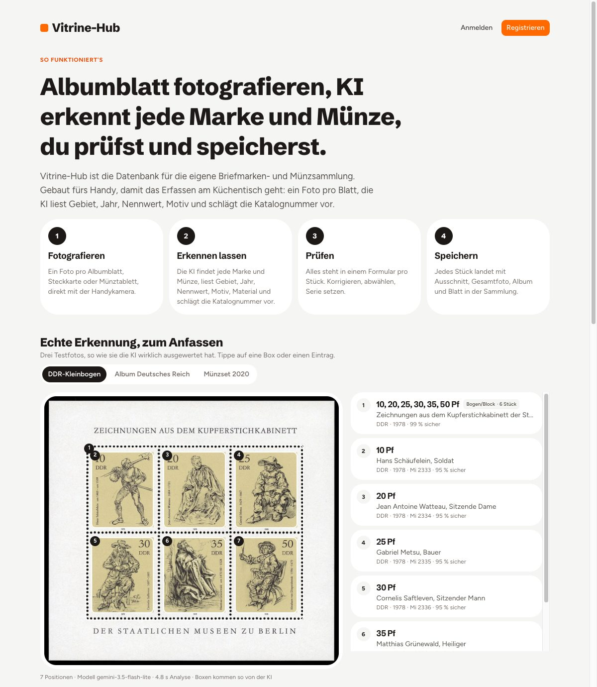
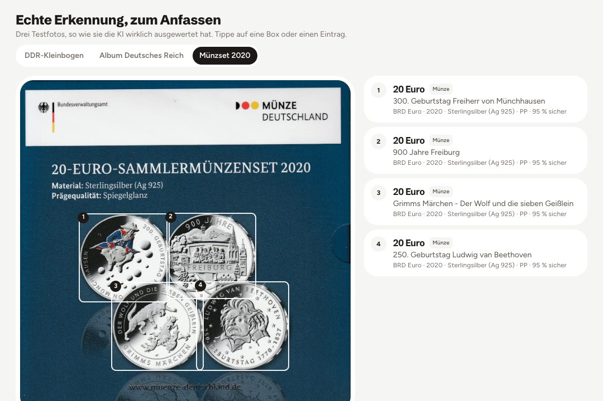
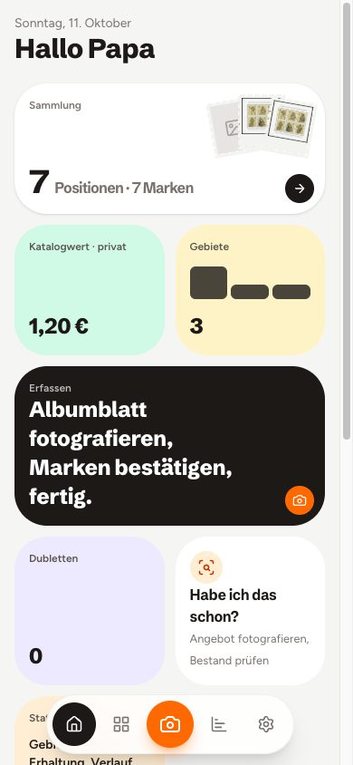
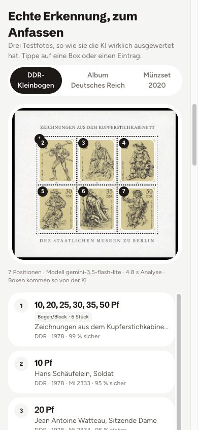
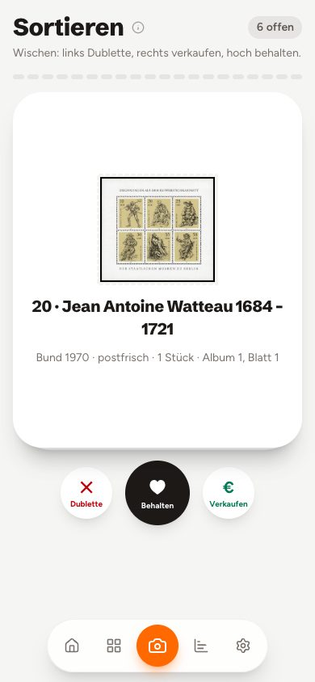
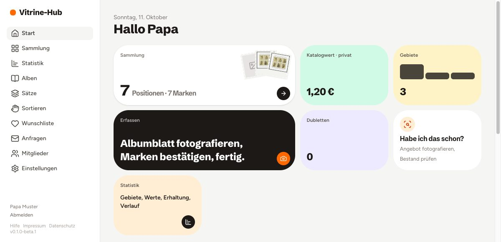
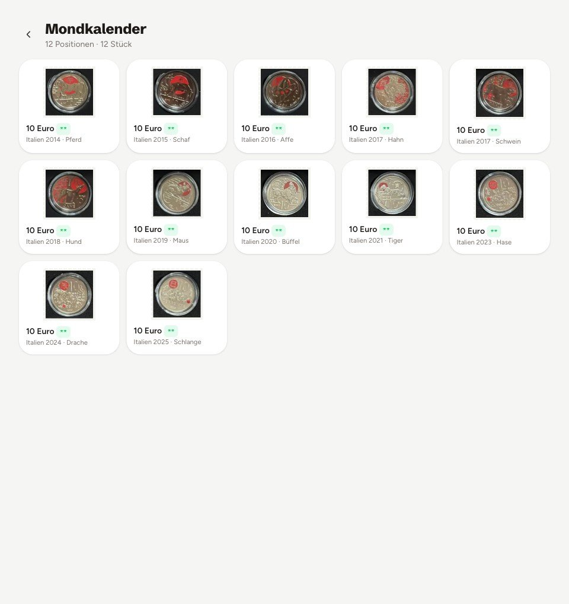
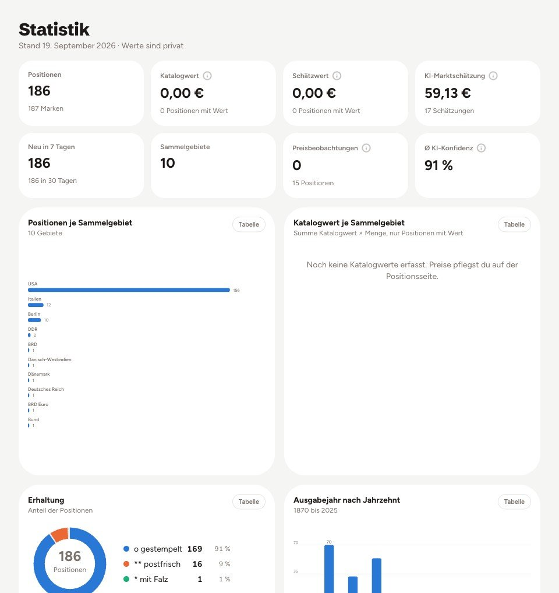
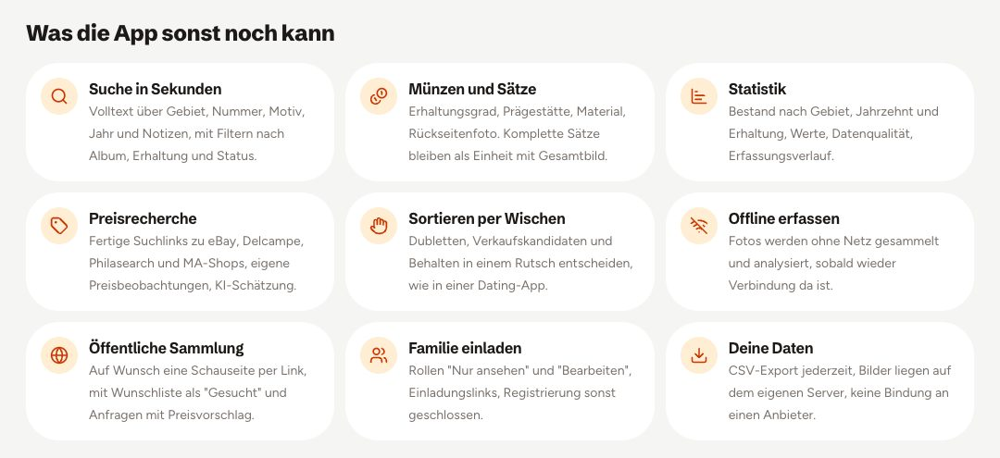

<div align="center">

# Vitrine-Hub

**Deine Sammlung, sauber erfasst. Briefmarken, Münzen, Sätze und mehr.**

Albumblatt fotografieren, die KI erkennt jedes Stück, du prüfst und speicherst.
Selbst gehostet, gebaut fürs Handy, mit der KI deiner Wahl.

*Self-hosted collection manager for stamps, coins and other collectibles. Snap a photo of an album page, the AI recognises every piece, you review and save. Statistics, price research, wishlist and an optional public showcase. UI in German.*

[](https://github.com/count-core/Vitrine-hub/actions/workflows/ci.yml)




</div>

## Ein Foto, jedes Stück erkannt

Ein Bild pro Albumblatt, Steckkarte oder Münztablett reicht. Die KI setzt um jedes Stück eine Box und liest Gebiet, Jahr, Nennwert, Motiv, Material und Erhaltung. Dazu schlägt sie die Michel- oder Jaeger-Nummer vor. Im Prüf-Schritt korrigierst du, was nicht passt, und speicherst alles auf einmal.

<p align="center">
  
</p>

## Gebaut fürs Handy

Erfassen am Küchentisch, Sortieren auf dem Sofa, Nachschauen auf der Börse. Vitrine-Hub lässt sich als App auf den Startbildschirm legen und sammelt Fotos auch ohne Netz.

<p align="center">
  
  &nbsp;
  
  &nbsp;
  
</p>

## Alles im Blick

<p align="center">
  
</p>

| Sätze mit Gesamtbild | Statistik |
|:---:|:---:|
|  |  |

Die Erkennung mit echten Ergebnissen kannst du auf der Seite `/so-funktionierts` jeder Installation ausprobieren, ganz ohne Konto.

<p align="center">
  
</p>

> **Beta.** Version 0.1.0-beta.1 läuft im Alltagsbetrieb und ist vollständig nutzbar. Das Datenmodell kann sich vor 1.0 noch ändern, deshalb vor Updates ein Backup von Datenbank und Bildern anlegen. Änderungen stehen im [Changelog](CHANGELOG.md).

## Funktionen

- **Erfassen per Foto**: ein Bild pro Albumblatt, Steckkarte oder Münztablett. Die KI liefert pro Stück eine Box, Gebiet, Jahr, Nennwert, Motiv, Farbe, Erhaltung, Serie und einen Vorschlag für die Michel- oder Jaeger-Nummer. Ausschnitte werden automatisch aufrecht gedreht, das Gesamtfoto bleibt erhalten.
- **Münzen und Sätze**: Erhaltungsgrad (s bis PP), Prägestätte, Material, Rückseitenfoto mit Nachfrage vor dem Speichern. Kursmünzensätze und Markensätze als Einheit mit Gesamtbild und eigener Satzansicht.
- **Suche und Filter**: Volltext mit Ähnlichkeitssuche (pg_trgm) über alle Felder, Filter nach Album, Gebiet, Erhaltung, Status, Typ.
- **Statistik**: Bestand nach Gebiet, Jahrzehnt, Erhaltung, Status, Werte, Datenqualität, Erfassungsverlauf. Jedes Diagramm mit Tabellenansicht.
- **Preisrecherche**: fertige Suchlinks (eBay verkauft und aktuell, Delcampe, Philasearch oder MA-Shops, Catawiki, Colnect) je nach Typ, eigene Preisbeobachtungen mit Median und Spanne, KI-Schätzung als Orientierung.
- **Sortieren per Wischen**: Dublette, zum Verkauf oder behalten in einem Rutsch, mit Rückgängig.
- **Wunschliste mit Lückensuche**: Wünsche mit eigenem Foto und Zielpreis. Die App findet fehlende Katalognummern im Bestand, die KI schlägt fehlende Ausgaben einer Serie vor, und das Preisradar vergleicht deinen Zielpreis mit beobachteten Preisen und KI-Schätzung.
- **Habe ich das schon?**: Auf der Börse ein Angebot fotografieren. Die App gleicht jedes erkannte Stück mit Sammlung und Wunschliste ab und zeigt, was du schon hast.
- **Offline erfassen**: als PWA installierbar, Fotos werden ohne Netz gesammelt und später analysiert.
- **Öffentliche Sammlung**: Schauseite per Link oder für Suchmaschinen, Wunschliste als "Gesucht", Anfragen mit Preisvorschlag ohne sichtbare E-Mail. Preise, Lagerort und private Notizen bleiben immer verborgen.
- **Mitglieder und Rollen**: Eigentümer, Bearbeiten, Nur ansehen. Einladungslinks statt offener Registrierung.
- **Eigene KI**: Google Gemini (kostenlos), OpenAI, Anthropic, Mistral, Groq, OpenRouter, Ollama lokal oder jeder OpenAI-kompatible Server, mit Anleitung in der App. Schlüssel werden verschlüsselt gespeichert.
- **Deine Daten**: CSV-Export, Bilder auf dem eigenen Server, keine Telemetrie, keine Tracker.

## Schnellstart (Entwicklung)

Voraussetzungen: Node 22 oder neuer, pnpm 10, Docker.

```bash
git clone https://github.com/count-core/Vitrine-hub.git && cd Vitrine-hub
cp .env.example .env          # BETTER_AUTH_SECRET setzen, GEMINI_API_KEY eintragen
pnpm install
docker compose up -d          # PostgreSQL 17
pnpm db:migrate               # Schema anlegen
pnpm dev                      # http://localhost:3000
```

Erstes Konto unter `/register` anlegen. Danach `ALLOW_SIGNUP=false` setzen; weitere Personen kommen über Einladungslinks aus **Mitglieder** dazu.

Einen kostenlosen Gemini-Schlüssel gibt es unter https://aistudio.google.com/apikey. Alternativ in den Einstellungen der App einen anderen Anbieter hinterlegen.

## Selbst hosten

**Mit Docker Compose** (App und Datenbank, Port 3000 nur lokal gebunden, Reverse-Proxy mit HTTPS davor):

```bash
cp .env.example .env          # BETTER_AUTH_SECRET, BETTER_AUTH_URL=https://deine-domain, ALLOW_SIGNUP, KI, LEGAL_*
docker compose -f docker-compose.prod.yml up -d --build
```

**Mit Coolify**: Repository als Docker-Compose-Ressource mit `docker-compose.coolify.yml` anlegen. Coolify erzeugt Datenbank-Zugang und Auth-Secret selbst, die Domain kommt über `SERVICE_FQDN_APP_3000`. Weitere Variablen (`GEMINI_API_KEY`, `ALLOW_SIGNUP`, `LEGAL_*`) in den Umgebungsvariablen der Ressource setzen.

Migrationen laufen beim Start automatisch (`RUN_MIGRATIONS=true`). Bilder liegen im Volume `uploads`, die Datenbank in `pg-data`. Beides sichern.

### Umgebungsvariablen

| Variable | Pflicht | Bedeutung |
|---|---|---|
| `DATABASE_URL` | ja | PostgreSQL-Verbindung |
| `BETTER_AUTH_SECRET` | ja | mindestens 32 zufällige Zeichen, `openssl rand -base64 48` |
| `BETTER_AUTH_URL` | ja | öffentliche URL der Installation |
| `ALLOW_SIGNUP` | | `true` nur zum Anlegen der ersten Konten |
| `UPLOAD_DIR` | | Ablage der Bilder, Standard `./data/uploads` |
| `AI_PROVIDER`, `GEMINI_API_KEY`, `GEMINI_MODEL`, `GEMINI_FALLBACK_MODELS`, `OLLAMA_URL`, `OLLAMA_MODEL` | | Server-Standard für die KI, in der App pro Sammlung überschreibbar |
| `AI_KEY_SECRET` | | eigener Schlüssel zum Verschlüsseln hinterlegter API-Keys, sonst `BETTER_AUTH_SECRET` |
| `APP_NAME`, `REPO_URL` | | Name und Quellcode-Link im Footer |
| `LEGAL_NAME`, `LEGAL_ADDRESS`, `LEGAL_EMAIL`, `LEGAL_PHONE`, `LEGAL_VAT_ID` | für öffentlichen Betrieb | Impressum und Datenschutz |

Alle Variablen mit Erklärung: [`.env.example`](.env.example).

## Technik

Nuxt 4 mit Nuxt UI 4 und Tailwind 4, Drizzle ORM auf PostgreSQL 17 (pg_trgm für die Suche), Better Auth, Sharp für Bilder, @vite-pwa/nuxt für Offline-Betrieb. KI-Anbindung über eigene Adapter für Gemini, OpenAI-kompatible APIs, Anthropic und Ollama mit JSON-Schema-Antworten.

```
app/            Seiten, Komponenten, Composables (Nuxt srcDir)
server/api/     REST-Endpunkte (h3)
server/utils/   Zugriff, Bilder, KI, Preise, Speicher
server/db/      Drizzle-Schema und SQL-Migrationen
shared/utils/   Anbieter-Katalog (Client und Server)
tests/          Vitest, Fixtures (Testbilder)
docs/           Screenshots
```

Prüfen: `pnpm check` (Typecheck und Tests), `pnpm build`. Die CI unter `.github/workflows/ci.yml` macht dasselbe plus `pnpm audit`.

## Sicherheit

Siehe [SECURITY.md](SECURITY.md) für Meldeweg, Schutzmaßnahmen und Betreiberpflichten. Kurzfassung: Konto-Pflicht, Rollen serverseitig geprüft, Bilder nur nach Berechtigung, verschlüsselte API-Keys, CSP und HSTS, Rate-Limits, SSRF-Schutz für eigene KI-Adressen.

## Mitmachen und Lizenz

Beiträge sind willkommen, siehe [CONTRIBUTING.md](CONTRIBUTING.md). Änderungen je Version: [CHANGELOG.md](CHANGELOG.md). Lizenz: [MIT](LICENSE).
